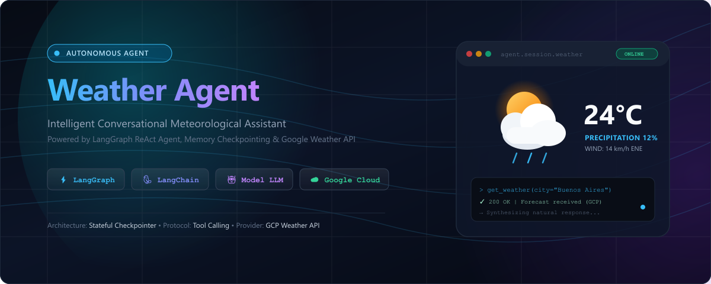
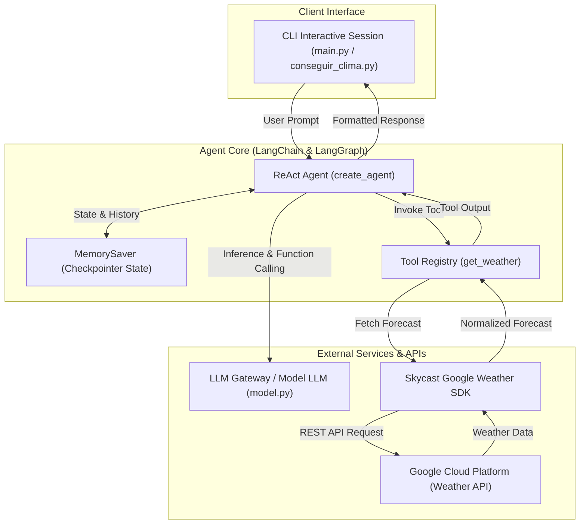
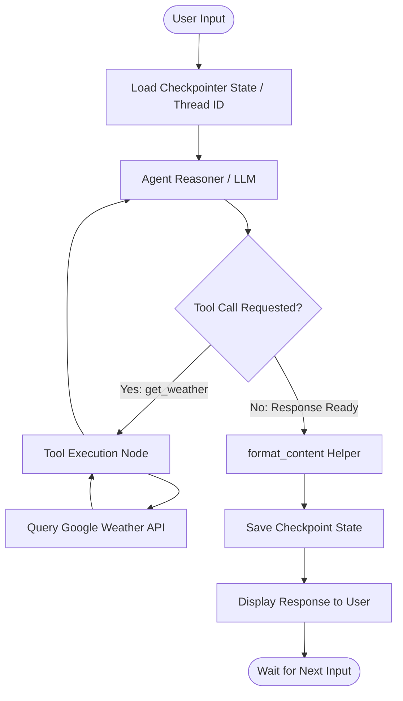
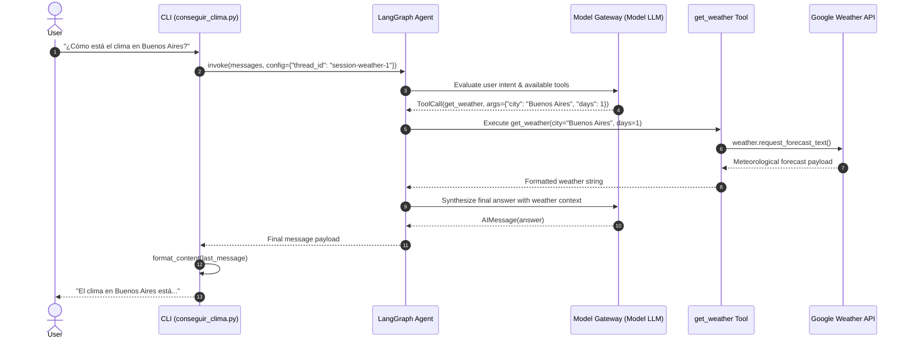

# Weather Chatbot Agent



An intelligent conversational weather assistant powered by **LangChain**, **LangGraph** (with memory checkpointing), and **Skycast Google Weather**.

---

## Architecture Overview

### Project Structure

```
weather_agent/
├── assets/
│   ├── cover.png        # High-resolution repository banner
│   └── cover.svg        # Scalable vector source for banner
├── conseguir_clima.py   # Core weather agent logic and interactive CLI loop
├── main.py              # Application entry point
├── model.py             # Chat model configuration via init_chat_model
├── utils.py             # Response normalization and message parsing helpers
├── pyproject.toml       # Modern Python packaging configuration (uv/poetry/pip)
├── requirements.txt     # Standard pip dependency manifest
├── .env.example         # Environment variables template
└── .gitignore           # Git ignore rules for Python, virtualenvs, and secrets
```

### System Architecture Diagram



### LangGraph Agent State Cycle



### Execution Sequence Flow



---

## Google Cloud Platform (GCP) Configuration

To run this agent with Google Weather integration, you must configure a Google Cloud project with the necessary APIs enabled.

### Required Google Services & APIs

1. **Google Maps Platform — Weather API** (`weather.googleapis.com`):
   - **Purpose:** Core meteorological data provider delivering current conditions, hourly forecasts, and multi-day predictions powered by Google DeepMind weather prediction models.
   - **Environment Variable:** `API_KEY_GOOGLE_CLIMA`

2. **Geocoding API** (`geocoding-backend.googleapis.com`):
   - **Purpose:** Translates free-form city names (e.g., "Buenos Aires", "Madrid") into geographic latitude/longitude coordinates required by meteorological query endpoints.

3. **Vertex AI API** (`aiplatform.googleapis.com`) or **Generative Language API** (`generativelanguage.googleapis.com` - Optional):
   - **Purpose:** Only required if connecting directly to Google Gemini models rather than through an external OpenAI-compatible gateway (`BASE_URL`).

### Setup Steps in GCP Console

1. Navigate to the [Google Cloud Console](https://console.cloud.google.com/).
2. Create a new project or select an existing project.
3. Enable Billing on the project (required by Google Maps Platform, which includes a monthly recurring credit).
4. Go to **APIs & Services** > **Library** and enable:
   - **Weather API**
   - **Geocoding API**
5. Go to **APIs & Services** > **Credentials**:
   - Click **Create Credentials** > **API Key**.
   - Copy the generated key into your `.env` as `API_KEY_GOOGLE_CLIMA`.
   - **Security Best Practice:** Restrict the API key under **API restrictions** to only allow calls to the _Weather API_ and _Geocoding API_.

---

## Requirements

- Python 3.10+
- An API key for your LLM Gateway / OpenAI compatible endpoint
- An API key for Google Weather via `skycast-google`

---

## Installation & Setup

### 1. Clone & Navigate to the Project

```bash
cd weather_agent
```

### 2. Set up a Virtual Environment

**Using `uv` (Recommended):**

```bash
uv venv
# On Windows:
.venv\Scripts\activate
# On Linux/macOS:
source .venv/bin/activate
uv pip install -e .
```

**Using standard `venv` + `pip`:**

```bash
python -m venv .venv
# On Windows:
.venv\Scripts\activate
# On Linux/macOS:
source .venv/bin/activate
pip install -r requirements.txt
```

---

## Configuration

Copy `.env.example` to `.env` and fill in your credentials:

```bash
cp .env.example .env
```

| Variable               | Description                                | Default                        |
| ---------------------- | ------------------------------------------ | ------------------------------ |
| `API_KEY`              | API Key for LLM service                    | Required                       |
| `BASE_URL`             | Base URL for LLM provider API              | `https://api.llmgateway.io/v1` |
| `MODEL_NAME`           | Model identifier                           | `gemini-3.5-flash-lite`        |
| `API_KEY_GOOGLE_CLIMA` | API Key for Skycast Google Weather service | Required                       |

---

## Usage

Start the interactive CLI chatbot:

```bash
python main.py
```

_Or directly:_

```bash
python conseguir_clima.py
```

Type your weather queries (e.g., _"¿Cómo está el clima en Buenos Aires?"_, _"Pronóstico para los próximos 3 días en Madrid"_) or type `salir` / `exit` to quit.
